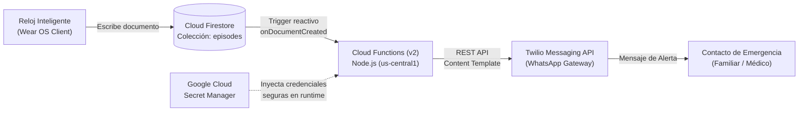

# GlycoPulse Backend — Servicio de Alertas de Emergencia

Servicio backend *serverless* orientado a eventos diseñado para la plataforma **GlycoPulse** (aplicación médica / monitoreo en Wear OS). Su función principal es procesar en tiempo real los episodios críticos de hipoglucemia o hiperglucemia detectados en el dispositivo del usuario y despachar notificaciones inmediatas a los contactos de emergencia a través de WhatsApp mediante la API de Twilio.

---

## 🏛️ Arquitectura Orientada a Eventos

El backend opera bajo un modelo reactivo completamente desacoplado y sin servidor (*serverless*), garantizando alta disponibilidad, escalabilidad bajo demanda y latencia mínima.



### Flujo del Proceso:
1. **Cliente Wear OS**: Al evaluar los niveles de glucosa y síntomas del paciente, si el algoritmo clasifica el estado como crítico, inserta un nuevo documento en la colección `episodes` de Cloud Firestore.
2. **Disparador Cloud Firestore**: La Cloud Function (`sendEmergencySms`) se activa de forma reactiva ante el evento `onDocumentCreated` en la ruta `episodes/{episodeId}`.
3. **Filtro y Sanitización en Cloud Functions**: La función valida que el nivel de riesgo sea `ALTO` o `HIGH`. Sanitiza los síntomas (concatenando listas si vienen en formato arreglo) y extrae los metadatos relevantes.
4. **Google Cloud Secret Manager**: Desencripta y provee de forma segura en memoria las credenciales de Twilio y el número de emergencia sin exponer secretos en el código ni en variables de entorno públicas.
5. **Twilio WhatsApp API**: La función despacha la notificación a través del servicio de mensajería empresarial de Twilio hacia el número del contacto de emergencia.

---

## 📋 Estructura de Datos en Firestore (`episodes`)

La Cloud Function escucha la colección `episodes`. A continuación se describe el esquema esperado del documento:

| Campo | Tipo | Requerido | Descripción |
| :--- | :--- | :--- | :--- |
| `riskLevel` | `string` | **Sí** | Nivel de riesgo detectado (`'HIGH'` o `'ALTO'` para activar el envío; otros niveles son omitidos). |
| `symptoms` | `Array<string>` \| `string` | No | Lista o descripción de síntomas detectados (ej: `['MAREO', 'SUDORACION']`). |
| `userName` | `string` | No | Nombre del paciente o usuario (por defecto: `"el usuario"`). |
| `timestamp` | `number` | **Sí** | Marca de tiempo en milisegundos (`Date.now()`) del registro del episodio. |
| `glucoseLevel` | `number` | No | Lectura de glucosa en mg/dL asociada al evento. |

### Ejemplo de Documento JSON:

```json
{
  "riskLevel": "HIGH",
  "userName": "Carlos Perez",
  "symptoms": ["DIZZINESS", "SWEATING", "TREMORS"],
  "glucoseLevel": 54,
  "timestamp": 1732368000000
}
```

---

## 🔐 Seguridad y Gestión de Secretos

Para cumplir con las mejores prácticas de seguridad en la nube y directivas de desarrollo seguro:

- **Google Cloud Secret Manager**: Se utiliza `defineSecret` de `firebase-functions/params` para delegar la custodia de valores confidenciales.
- **Sin Credenciales en el Repositorio**: El código fuente no contiene tokens de acceso, contraseñas ni números telefónicos en texto plano.
- **Sanitización en Tiempo de Ejecución**: Cada secreto es leído mediante `.value().trim()` para erradicar espacios en blanco o saltos de línea invisibles que puedan invalidar la autenticación básica HTTP con Twilio.

### Secretos requeridos por la función:

- `TWILIO_ACCOUNT_SID`: Identificador de cuenta de Twilio.
- `TWILIO_AUTH_TOKEN`: Token de autenticación de Twilio.
- `TWILIO_PHONE_NUMBER`: Número del canal de WhatsApp de Twilio (Sandbox o comercial).
- `EMERGENCY_CONTACT_NUMBER`: Número telefónico del contacto de emergencia en formato internacional E.164 (ej: `+573001234567`).

---

## 🧪 Consideraciones del Entorno de Pruebas (Twilio Sandbox)

Durante fases de desarrollo, pruebas piloto y demostraciones académicas, se deben tener en cuenta las siguientes restricciones impuestas por la API de WhatsApp de Twilio:

1. **Uso de Plantillas Predefinidas (`contentSid`)**:
   En cuentas de prueba (Sandbox), WhatsApp prohíbe el envío de mensajes con texto libre iniciado por el negocio (*Business-Initiated*). Es obligatorio utilizar una plantilla aprobada (Content Template ID: `HXfe5ab5f00277942d4d4200328b4d403c`) e inyectar los datos en los parámetros dinámicos `contentVariables` (`'1'` para encabezado/riesgo y `'2'` para el cuerpo/síntomas).

2. **Ventana de Sesión de 72 Horas**:
   El destinatario de emergencia debe haber vinculado previamente su WhatsApp enviando el código de activación (ejemplo: `join <sandbox-keyword>`) al número del Sandbox de Twilio. Dicha asociación expira periódicamente (habitualmente cada 72 horas en Sandbox), requiriendo reconfirmar el código antes de ejecutar demostraciones en vivo.

---

## 🚀 Despliegue

### Prerrequisitos:
- Node.js 20+ y npm instalados.
- Firebase CLI autenticado (`firebase login`).
- Proyecto activo seleccionado (`firebase use glycopulse-4858f`).

### 1. Configurar los secretos (si es la primera vez):
```bash
firebase functions:secrets:set TWILIO_ACCOUNT_SID
firebase functions:secrets:set TWILIO_AUTH_TOKEN
firebase functions:secrets:set TWILIO_PHONE_NUMBER
firebase functions:secrets:set EMERGENCY_CONTACT_NUMBER
```

### 2. Desplegar la Cloud Function:
```bash
firebase deploy --only functions
```

### 3. Monitoreo de Logs en Vivo:
```bash
firebase functions:log
```
